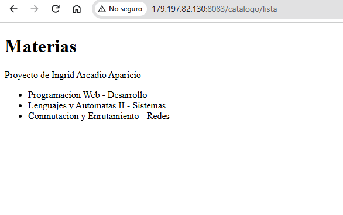
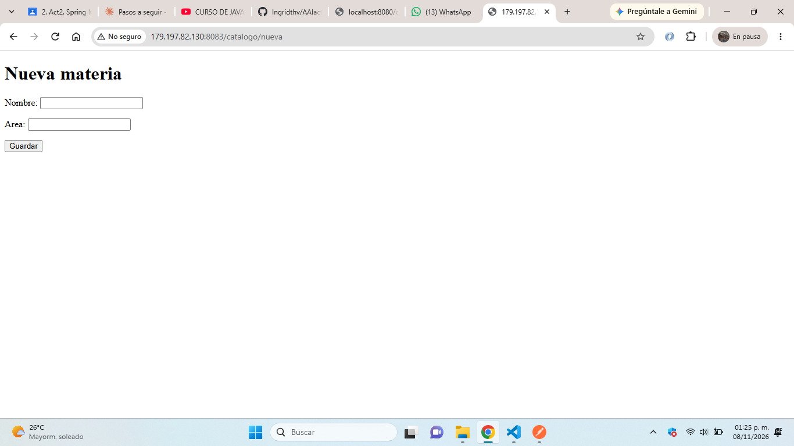
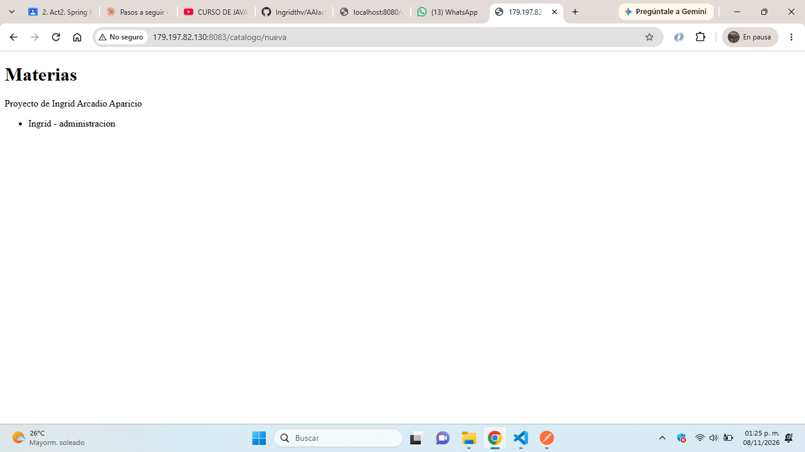
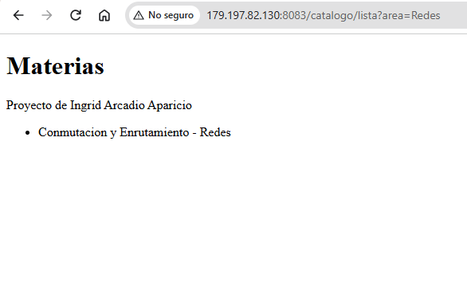
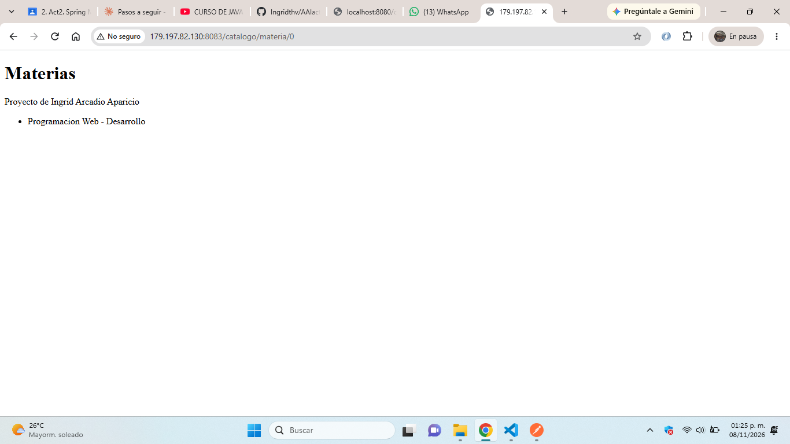
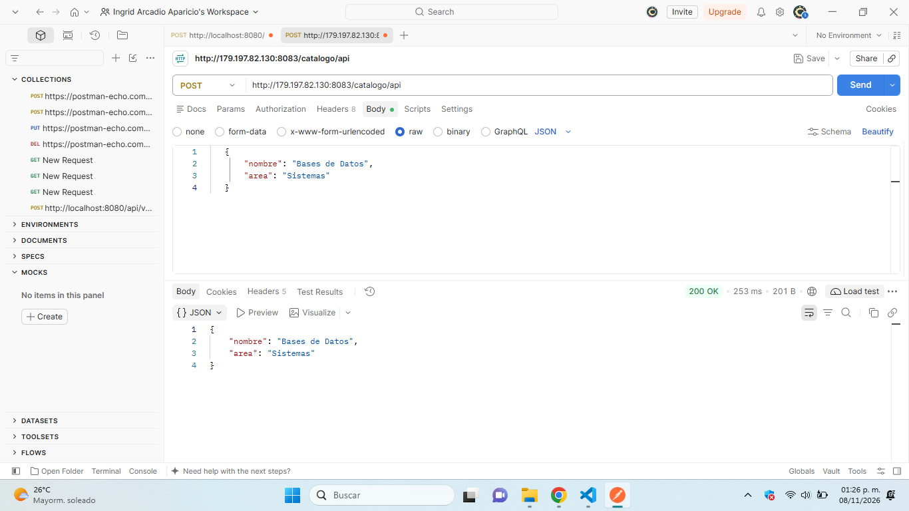

# AAIact2_t4

**Autora:** Ingrid Arcadio Aparicio

**Actividad:** Act2. Spring MVC: Vistas con Thymeleaf, DTO y manejo de parámetros

## Descripción

Este proyecto es una copia de la Actividad 1. Se agregaron vistas con Thymeleaf, una clase DTO, endpoints con `@RequestParam` y `@PathVariable`, un formulario con `@ModelAttribute`, una propiedad leída con `@Value` y un endpoint POST probado en Postman.

## Archivos elaborados

| Archivo | Función |
|---|---|
| `MateriaDTO.java` | DTO con el nombre y el área de una materia |
| `MateriaController.java` | Controlador MVC que devuelve vistas y un POST en JSON |
| `lista.html` | Vista que recorre las materias con `th:each` |
| `formulario.html` | Formulario para registrar una materia |
| `application.properties` | Contiene la propiedad `app.autora` |

## Endpoints

| Función | Método | Enlace |
|---|---|---|
| Lista con `th:each` y `@Value` | GET | http://179.197.82.130:8083/catalogo/lista |
| Filtro con `@RequestParam` | GET | http://179.197.82.130:8083/catalogo/lista?area=Redes |
| Detalle con `@PathVariable` | GET | http://179.197.82.130:8083/catalogo/materia/0 |
| Formulario con `@ModelAttribute` | GET y POST | http://179.197.82.130:8083/catalogo/nueva |
| POST REST con el DTO | POST | http://179.197.82.130:8083/catalogo/api |

## Capturas

### Lista con `th:each` y `@Value`

### Formulario con `@ModelAttribute`

### Resultado del formulario

### Filtro con `@RequestParam`

### Detalle con `@PathVariable`

### POST probado en Postman

## Despliegue

- **Actividad 2:** puerto **8083**, en la carpeta `~/act2` del VPS.
- **Actividad 1:** sigue corriendo en el puerto **8082**.